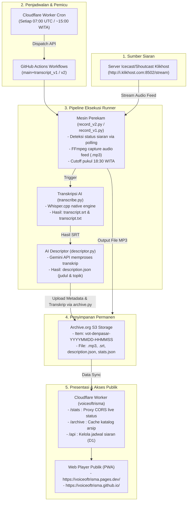

# 01 — Arsitektur & Peta Alur Sistem

Dokumen ini menjelaskan arsitektur menyeluruh dari sistem Voice of Trisma (VOT), bagaimana data audio mengalir dari radio siaran langsung hingga tersimpan sebagai arsip digital publik.

---

## 🗺️ Diagram Alur Menyeluruh (End-to-End Pipeline)

---

## 🧩 Komponen-Komponen Utama

### 1. Sumber Audio Siaran (Klikhost Icecast)
* **Endpoint Audio**: `http://i.klikhost.com:8502/stream`
* **Endpoint Status**: `http://i.klikhost.com:8502/stats?json=1`
* Server streaming berbasis Shoutcast/Icecast yang memancarkan siaran radio secara analog/digital.

### 2. Orkestrasi Pemicu (Cloudflare Cron Trigger)
* Setiap hari pukul **07:00 UTC** (~15:00 WITA), Worker `voiceoftrisma` mengeksekusi modul `workflow.ts` untuk memicu (*dispatch*) alur kerja GitHub Actions:
  * `main+transcript_v1.0.yml` (Engine Chunking - Cadangan)
  * `main+transcript_v2.0.yml` (Engine Stdin Piping - Utama)

### 3. Mesin Perekam (`main/record_v1.py` & `main/record_v2.py`)
* Menggunakan paket modular `main/core/`.
* Polling status siaran adaptif (3 detik hingga 90 detik).
* Menghentikan rekaman secara otomatis tepat pukul **18:30 WITA**.

### 4. Transkripsi AI (`main/transcribe.py`)
* Menjalankan biner native `whisper-cli` berarsitektur `x86-64`.
* Mengubah rekaman audio menjadi teks berwaktu (*timestamped subtitle*) berformat `.srt` dan `.txt`.

### 5. AI Descriptor (`main/descriptor.py`)
* Membaca berkas `.srt`, lalu mengirimkannya ke Google Gemini API.
* Gemini menghasilkan ringkasan siaran, topik pembicaraan, dan metadata dalam bentuk `description.json`.

### 6. Pengarsipan S3 Archive.org (`main/archive.py`)
* Menggunakan library `internetarchive` dengan kredensial S3 `IA_ACCESS_KEY` dan `IA_SECRET_KEY`.
* Membuat item baru di Archive.org dengan format identitas:
  `vot-denpasar-YYYYMMDD-HHMMSS`

### 7. Distribusi Web & CDN (Cloudflare Worker & Pages)
* **Cloudflare Worker** bertindak sebagai backend API, proxy CORS, penyimpan jadwal di Cloudflare D1, dan cache katalog rekaman.
* **Cloudflare Pages** (`voiceoftrisma.pages.dev`) dan **GitHub Pages** (`voiceoftrisma.github.io`) menyajikan antarmuka pengguna berbasis web statis dan Progressive Web App (PWA).
