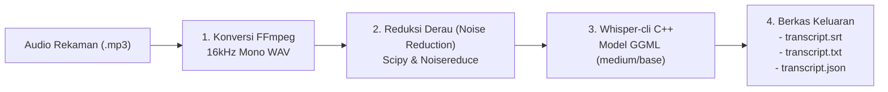

# 03 — Pipa Transkripsi & AI

Bab ini menjelaskan bagaimana berkas rekaman suara diproses menjadi transkrip teks berwaktu (*timestamped SRT*) menggunakan model AI Whisper, serta bagaimana Google Gemini AI digunakan untuk mengekstrak ringkasan siaran.

---

## 🎙️ Mesin Transkripsi Native (`main/transcribe.py`)

Skrip `transcribe.py` mengorkestrasi eksekusi biner C++ native **`whisper-cli`** (berada di folder `bin/linux-x64/` atau `bin/win-x64/`):

```bash
python main/transcribe.py <input_audio.mp3_atau_URL> [model]
```

### 1. Tahapan Pemrosesan Audio (Audio Pipeline)



1. **Standardisasi Frekuensi**: Audio masukan dikonversi menggunakan FFmpeg ke format standar Whisper: **16.000 Hz, 1 channel (mono), 16-bit PCM WAV**.
2. **Pembersihan Derau (*Noise Reduction*)**: Menggunakan pustaka `noisereduce` untuk membersihkan desis (*white noise/hiss*) yang sering muncul pada gelombang siaran radio FM/AM sebelum diserahkan ke model AI.
3. **Deteksi Aktivitas Suara (*VAD*)**: Memilah bagian keheningan (*silence*) dan hanya memproses potongan audio yang memuat percakapan manusia.

---

## 🧠 Model Whisper GGML yang Didukung

`transcribe.py` otomatis mengunduh berkas bobot model AI dari HuggingFace/GitHub jika belum tersedia secara lokal di komputer:

| Nama Model | Ukuran Model | Akurasi Bahasa Indonesia | Kecepatan CPU | Rekomendasi Pemakaian |
| :--- | :---: | :---: | :---: | :--- |
| **`tiny`** | ~75 MB | Rendah | Sangat Cepat | Pengujian cepat lokal |
| **`base`** | ~142 MB | Cukup | Cepat | Komputer dengan spek rendah |
| **`small`** | ~466 MB | Baik | Sedang | Keseimbangan kecepatan & akurasi |
| **`medium`** | ~1.5 GB | **Sangat Baik** | Sedang | **Pilihan Default di GitHub Actions** |
| **`large-v3`** | ~3.1 GB | Luar Biasa | Lambat | Transkripsi offline kualitas arsip |

---

## 📝 Generator Deskripsi Siaran (`main/descriptor.py`)

Setelah berkas `transcript.srt` selesai dibuat, sistem mengeksekusi `descriptor.py` untuk menganalisis isi siaran menggunakan **Google Gemini API**:

```bash
python main/descriptor.py transcripts/transcript.srt -o transcripts/description.json -m gemini-2.5-flash
```

### Format Output `description.json`:
Gemini mengekstrak entitas penting dan menyimpannya dalam skema JSON terstruktur:

```json
{
  "judul": "Info Science & Warta Sains Trisma",
  "penyiar": "Vita",
  "tanggal": "2026-10-27",
  "ringkasan": "Membahas perkembangan teknologi AI dan eksplorasi luar angkasa terbaru...",
  "topik_utama": [
    "Kecerdasan Buatan",
    "Astronomi",
    "Teknologi Sekolah"
  ],
  "lagu_diputar": [
    "Coldplay - Fix You"
  ],
  "bahasa": "id"
}
```

Berkas `description.json` inilah yang nantinya dibaca oleh website VOT untuk menampilkan informasi acara, nama penyiar, dan ringkasan isi rekaman kepada pendengar.
