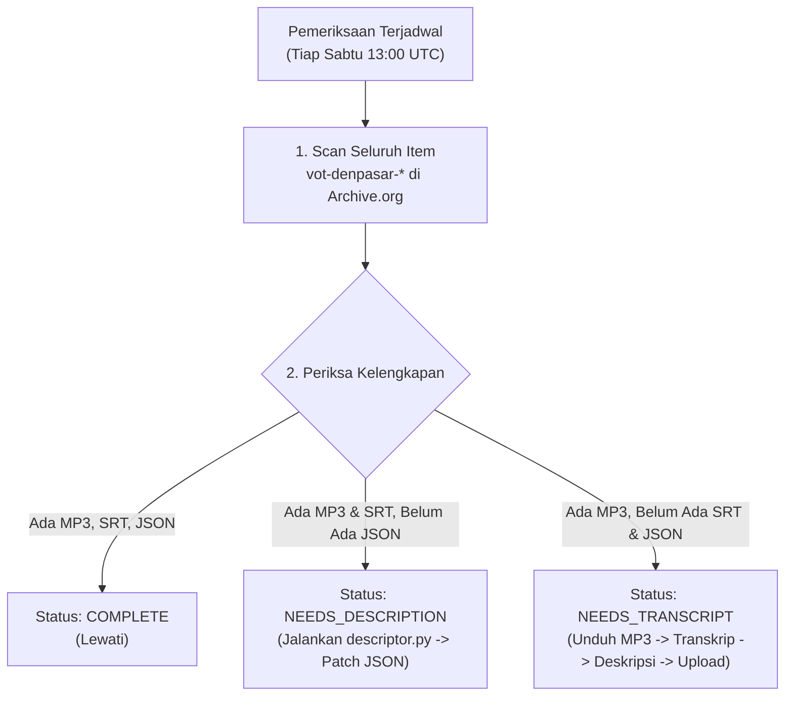

# 04 — Pengunggahan & Pengarsipan S3 (Archive.org)

Bab ini menjelaskan bagaimana sistem berinteraksi dengan API S3 **Internet Archive (Archive.org)** untuk menyimpan rekaman secara permanen dan gratis, serta bagaimana mekanisme *self-healing* dijalankan oleh **Pipeline Guard**.

---

## ☁️ Integrasi S3 Archive.org

Internet Archive menyediakan antarmuka kompatibel S3 yang memungkinkan pengunggahan file dan metadata tanpa batas kuota penyimpanan.

### Kredensial yang Digunakan:
* **`IA_ACCESS_KEY`**: S3 Access Key Archive.org akun pengunggah.
* **`IA_SECRET_KEY`**: S3 Secret Key Archive.org akun pengunggah.

Kedua variabel ini otomatis dimuat dari berkas root `.ENV` saat lokal atau dari **GitHub Secrets** saat di cloud.

---

## 📦 Struktur Item Arsip

Setiap sesi rekaman dibuatkan satu "Item" terpisah di Archive.org dengan konvensi penamaan berbasis waktu WITA:

$$\text{Item ID} = \texttt{vot-denpasar-YYYYMMDD-HHMMSS}$$

*Contoh:* `vot-denpasar-20261027-183000`

### Daftar Berkas di Dalam Satu Item:
1. `VOT-Denpasar_DD-MM-YY.mp3` — Berkas rekaman audio siaran utuh.
2. `transcript.srt` — Teks subtitle bersinkronisasi waktu.
3. `transcript.txt` — Naskah teks lengkap siaran.
4. `description.json` — Metadata judul, penyiar, topik, dan ringkasan dari Gemini AI.
5. `stats.json` *(Opsional)* — Log histori metrik koneksi proxy dan server selama perekaman.
6. `raw/*.mp3` *(Opsional di v1.0 jika `--with-raw` aktif)* — Potongan chunk mentah sebelum penggabungan.

---

## 🔄 Modul Pengunggah: `main/core/uploader.py` & `main/archive.py`

* **`uploader.py`**: Digunakan langsung oleh mesin perekam (`record_v1.py` dan `record_v2.py`) segera setelah rekaman selesai.
* **`archive.py`**: Digunakan untuk menyuntikkan transkrip dan deskripsi yang selesai diproses ke dalam Item yang sudah ada sebelumnya di Archive.org.

### Ekspor ke Lingkungan CI/CD:
Setelah upload berhasil, fungsi `write_env_variables()` menuliskan identifier ke berkas `$GITHUB_ENV`:
```bash
ARCHIVE_URL=https://archive.org/download/vot-denpasar-20261027-183000/VOT-Denpasar_27-10-26.mp3
ITEM_ID=vot-denpasar-20261027-183000
```
Variabel ini kemudian ditangkap oleh tahap (*job*) transkripsi berikutnya di GitHub Actions.

---

## 🛡️ Mekanisme Self-Healing: Pipeline Guard (`main/guard.py`)

Jika sebuah job transkripsi di GitHub Actions gagal (misalnya karena kuota API Gemini habis atau timeout runner), rekaman audio tetap aman di Archive.org, tetapi item tersebut menjadi tidak lengkap (*incomplete*).

**Pipeline Guard** bertindak sebagai "dokter" otomatis yang memulihkan rekaman yang belum lengkap:



### Cara Menjalankan Pipeline Guard Manual:
```bash
# Periksa status kesehatan 10 rekaman terakhir
python main/guard.py status --rows 10

# Perbaiki deskripsi item tertentu secara langsung
python main/guard.py fix-description --item-id vot-denpasar-20261027-183000
```
Pipeline Guard memastikan katalog siaran VOT di website selalu memiliki data transkrip dan ringkasan yang utuh.
