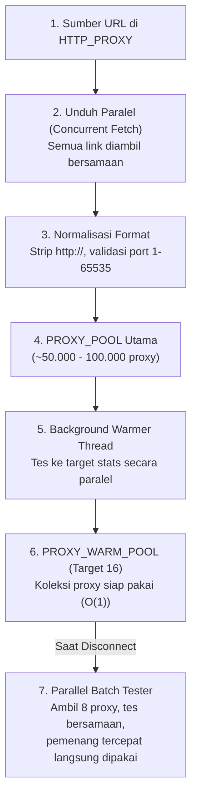

# 05 — Sistem Proxy & Warm Pool

Bab ini menjelaskan bagaimana sistem proxy otomatis (`main/core/proxy.py`) mengumpulkan ribuan proxy publik, memfilter yang valid, dan mengelola *Warm Pool* agar proses perekaman tidak terganggu oleh pemblokiran jaringan atau pembatasan IP server radio.

---

## 🎯 Mengapa Membutuhkan Proxy?
Server audio streaming radio (`Klikhost`) terkadang menerapkan *rate-limiting*, pembatasan koneksi simultan, atau pemblokiran blok IP datacenter tertentu (seperti IP runner GitHub Actions Azure). 

Sistem proxy memastikan recorder selalu memiliki jalur alternatif jika koneksi langsung diblokir atau terputus.

---

## 📋 Format Konfigurasi: `HTTP_PROXY`

Variabel **`HTTP_PROXY`** di `.ENV` atau GitHub Secrets **wajib berformat JSON Array String** yang memuat tautan sumber daftar proxy mentah (*raw plain text*):

```env
HTTP_PROXY='[
  "https://raw.githubusercontent.com/iplocate/free-proxy-list/refs/heads/main/protocols/http.txt",
  "https://raw.githubusercontent.com/proxifly/free-proxy-list/refs/heads/main/proxies/protocols/http/data.txt",
  "https://raw.githubusercontent.com/TheSpeedX/PROXY-List/refs/heads/master/http.txt",
  "https://raw.githubusercontent.com/wiki/gfpcom/free-proxy-list/lists/http.txt"
]'
```

---

## ⚡ Alur Kerja Multi-Stage Proxy



### 1. Pengunduhan Bersamaan (*Concurrent Fetch*)
Semua URL dalam array `HTTP_PROXY` diunduh secara serentak menggunakan `ThreadPoolExecutor`. Ribuan alamat proxy digabungkan ke memori tanpa menunggu URL satu per satu selesai.

### 2. Normalisasi Format
Alamat proxy yang memiliki format berbeda-beda dirapikan menjadi standar `ip:port` yang valid:
* `http://103.48.71.6:8080/` $\rightarrow$ `103.48.71.6:8080`
* Karakter spasi dan format rusak dibuang secara otomatis.

### 3. Kriteria Validasi Ketat (Anti-Fake Proxy)
Banyak proxy gratis di internet mengembalikan halaman iklan atau pesan kesalahan HTML dengan status HTTP 200. Untuk mencegah proxy palsu, sistem menerapkan dua syarat mutlak:
1. Kode status HTTP harus **`200 OK`**.
2. Isi teks respons **wajib mengandung kata kunci `"streamstatus"`** (menandakan respons asli dari server Klikhost).

---

## 🔥 Konsep Warm Pool (16 Proxy Siap Pakai)

Mengetes puluhan ribu proxy satu per satu saat siaran berlangsung akan memakan waktu terlalu lama dan menyebabkan rekaman terputus.

* **Solusi**: Saat recorder berada dalam tahap *tunggu siaran* (*wait for stream*), sebuah thread terpisah (`_proxy_warmer_loop`) bekerja di latar belakang.
* Thread ini terus mengisi antrean **`PROXY_WARM_POOL`** (menggunakan struktur data `collections.deque`) hingga terisi **16 proxy yang sudah terbukti hidup**.
* Begitu siaran radio *ON-AIR*, proxy pertama diambil dalam waktu $O(1)$ (instan tanpa delay scan).
* Jika koneksi putus di tengah siaran, fungsi `next_proxy_parallel_from_pool()` mengambil *batch* 8 proxy dari warm pool dan menguji semuanya secara serentak dalam 2 detik untuk menemukan pengganti tercepat.
